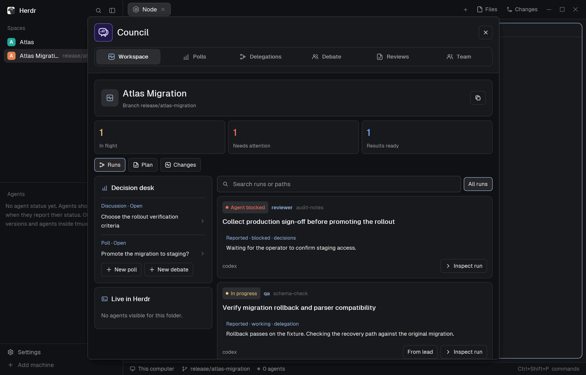
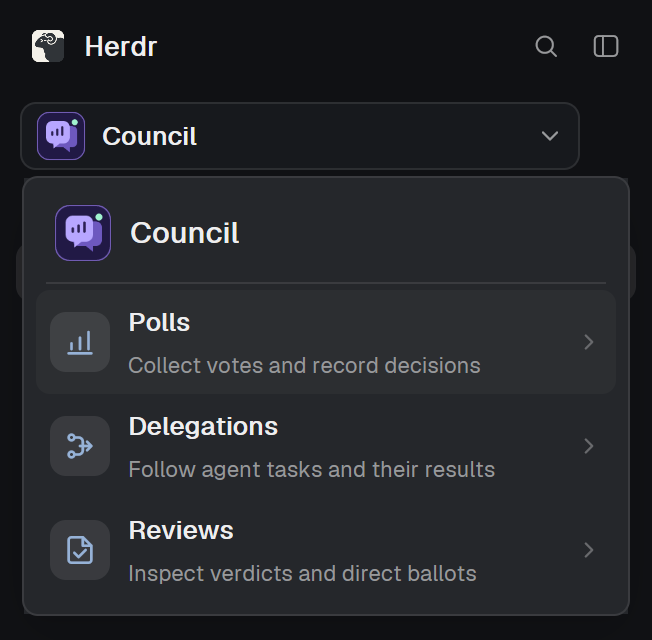
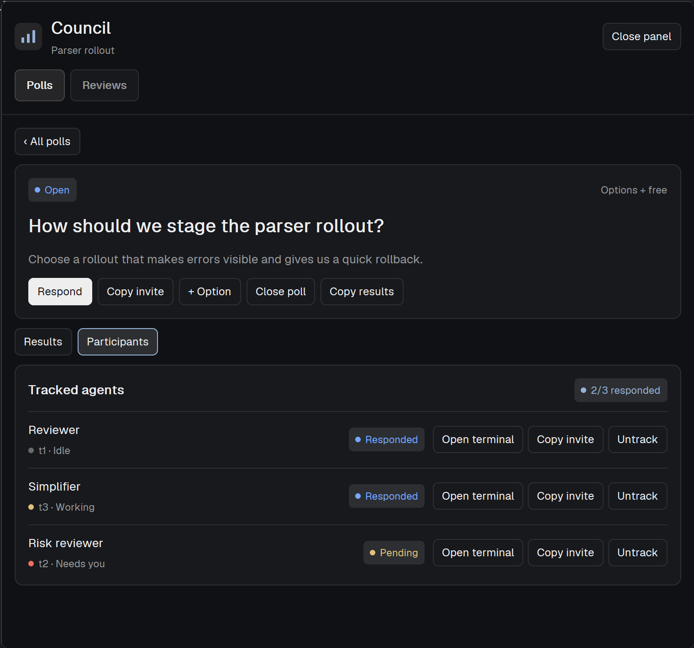
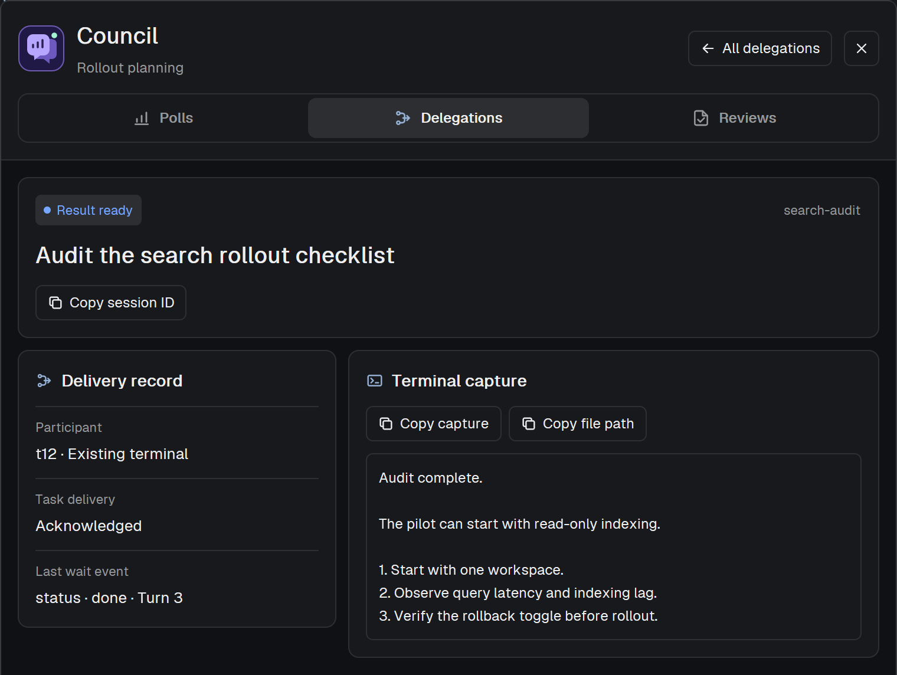

# Council for Herdr


Follow the work of your agents, coordinate a handoff, and record decisions. Open **Council** in the Herdr sidebar to see workspace activity, polls, delegations, debate threads, formal reviews, and Team roles.

[Install](#install) · [Workspace activity](#workspace-activity) · [Run a poll](#run-a-poll) · [CLI and MCP](#available-workflows) · [Gallery package](herdr/RECIPE.md)



| Open from the sidebar | Track participation | Follow delegations | Inspect formal reviews |
| --- | --- | --- | --- |
| [](herdr/screenshots/menu.png) | [](herdr/screenshots/participants.png) | [](herdr/screenshots/delegations.png) | [](herdr/screenshots/review.png) |

## Install

Open Herdr Desktop once to initialize your layouts. Council needs Node.js 20 or newer.

```bash
git clone https://github.com/ejupi-djenis30/council-herdr.git
cd council-herdr
node herdr/install.js --menu --shortcut
```

Open a local space and select **Council** under the Herdr logo. The menu opens **Polls**, **Delegations**, **Debate**, or **Reviews** directly. The optional **Shift+F8** binding and `herdr-app do mod.open --name council` also open Council.

- **Choose a layout.** The installer adds the menu to the active personal layout and archives the old file. For a layout shipped with Herdr, select the new `council-<name>` layout in Herdr using the name printed by the installer. Use `--menu --layout <name>` to target a different layout.
- **Update** a managed installation with `node herdr/install.js --upgrade --menu`. The old build is archived under the Herdr app home's `council-backups/`. An installation with local edits requires a manual backup before replacing it.
- **Install from the gallery bundle** by copying `herdr/mods/council/` into the app home's `mods/` directory. For native task launches, use the installer above to include the Council engine, or configure the manual copy with the absolute path to Council's CLI. [Gallery setup](herdr/RECIPE.md)
- **Use a custom app home** by passing `--app-home <path>` or setting `HERDR_APP_HOME`. To remove Council, remove the menu block and shortcut from your Herdr configuration before moving the mod out of `mods/`. Polls, delegations, and reviews live in their project folders.

## Run a poll

1. Select **New poll** and choose listed options, free responses, or both.
2. In **Invite agents**, select the terminals you want to invite, then select **Open poll**. Leave the list unselected to open without invitations. The rows show each agent's terminal, project folder and status. Open **Participants** to follow responses or copy a manual invitation.
3. Follow live responses in **Results**. You can add options while the poll is open, see replies from agents outside the roster, and jump to a live terminal from the participant list.
4. Close the poll with an optional next step. **Copy decision** captures the tally, reasons, and missing responses for the next person or agent.

**Polls** includes polls opened in Desktop or by agents through the CLI and MCP. **This space** includes the space folder and its terminal folders. Use **All local spaces** to see records from other open local spaces. Polls display their project and, when available, the terminal that opened them.

For a paired machine, install the Council Desktop package on that machine and open its Herdr space. Council runs the helper in the selected project on that machine. **All spaces on this machine** includes other open spaces on the same peer. Terminal IDs in the project's Council records use the IDs reported by that peer's core.

In **Debate**, select **New debate**, enter a topic, pick the agents to invite, and select **Start debate**. Agents can open the same thread with `council_debate_create` or `council debate create --question "<topic>"`. Pass selected terminal addresses as `recipients` in MCP or repeat `--invite <address>` on the CLI to start the invitation worker. Recipients must be live agents in one local Herdr space. Omit recipients to open a thread without messaging anyone. Use `debate list` or `council_debate_read` without an ID to find a thread in its project.

From a debate, **Create poll** pre-fills the question and context. Edit them, select recipients, and open the poll in the debate's project. Agents can link the poll using `sourceDebateId` in MCP or `poll create --debate <id>` on the CLI. Use **Close with decision**, `council_debate_close`, or `debate close <id> --decision "..." --owner "..." --next-step "..."` to record the handoff. The closed thread shows the decision, who recorded it, its owner, its next step, and its linked polls.

The invitation queue is saved before the worker starts. The worker runs in Herdr after the panel closes. If it stops, Council resumes pending deliveries when you reopen its panel in the original space, within the original 15-minute window. The panel checks for interrupted workers while open and displays each queue’s deadline. Use **Check setup** to ask the original terminal to register Council. After the window ends, **Retry** opens a fresh window for a confirmed unsent invitation. An invitation marked **Delivery uncertain** needs a check in the agent's terminal. Earlier queues without a saved space remain visible for manual inspection.

## Agent alignment

Agents register readiness through `council_alignment` using the current Council skill. Setup notices reach unknown agents before Council shares any task, poll ID or debate ID. Receipts apply to the current Herdr terminal and expire after eight hours. A reported setup issue stays visible in the invitation. See [Council host setup](docs/alignment.md) for configuring and refreshing a specific agent.

**Debate** also shows saved Council and review proposals, replies, and submitted ballots in chronological order. The view labels terminal captures and drafts and links to the formal review. In **Reviews** and the formal thread, a badge on each direct ballot shows whether its SHA-256 matches the recorded proposal for that round. **Reviews** displays the saved tally and verdict when available.

Select **Run agent debate** in **Debate** to assign speakers to an automated debate. In **Reviews**, select **Start review** for a new proposal. Once participant turns finish, **Refresh tally** incorporates eligible late ballots. **Start next round** opens a linked job tied to the original proposal. Return to the prior review with **Back**.

### Open or respond to a poll from an agent

Use `council_poll_create`, `council_poll_read`, and `council_poll_vote` through MCP. Use `council_poll_manage` to add an option, track or untrack a participant, or close the poll. Pass the same absolute `project` path throughout. Poll creation accepts the same invitation addresses as debate creation. To use the bundled poll CLI, run the installed `runtime/council.mjs` by absolute path from the target project directory. The repository CLI accepts the same commands.

```powershell
node C:/path/to/council-herdr/bin/council.js poll list
node C:/path/to/council-herdr/bin/council.js poll create --mode mixed --question "What should we review?" --option "Parser" --option "API"
node C:/path/to/council-herdr/bin/council.js poll show <poll-id>
node C:/path/to/council-herdr/bin/council.js poll vote <poll-id> --option option-1 --note "The diff identifies the exact revision"
node C:/path/to/council-herdr/bin/council.js poll help
```

Use `--answer "…"` for a free response when enabled. The CLI uses `HC_TERMINAL_ID` when available. Supply `--voter` (or MCP `voter`) for a stable ID when the process starts outside that terminal. Each ID can update its response until close. Advisory IDs are local labels. A read-only agent can return its recommendation in its current conversation.

Use `poll track <poll-id> --voter <id> --label "Reviewer"` and `poll untrack <poll-id> --voter <id>` to manage the roster from the CLI while a poll is open.

### Data and permissions

The panel reads Council records under `.agent_workspace/` in the local projects in scope. Poll actions write advisory events under `.agent_workspace/.polls/` in the poll's original project. Poll and debate writes use hard links to publish complete records when multiple agents submit concurrently. The project filesystem must support hard links. The panel uses the local clipboard for invitations and handoffs.

## Available workflows

| Mode | Behavior |
| --- | --- |
| `delegate` | One specialist receives a bounded task. Use `start`, `status` and `result` to follow it through a saved session. `delegate` is the blocking equivalent. |
| `council` | An author produces a proposal; a skeptic and simplifier receive that exact proposal and its SHA-256 digest. |
| `review` | An author produces a proposal; a reviewer and simplifier inspect it before the voting tally. |
| `debate` | Two agents make independent cases. A third compares the saved arguments and gives an advisory recommendation. |
| `parallel` | Agents work on independent assignments. Supply `subtasks` to give each one a different brief. |
| `pipeline` | Stages run in order. Each receives the previous stage’s saved capture and digest. |

Use `convene --mode debate|parallel|pipeline` or the corresponding `mode` in `council_convene`. Pass `--subtasks` or `--stages` as a JSON array on the CLI. A stage requires `name` and accepts `task`, `agent`, and `role`. The report and execution record are saved under `validation/`. Use `start` for background execution.

## Background runs, schedules, and voting rounds

In Desktop, **Schedules → New schedule** accepts any of the six workflows. Choose a start time and an optional repeat interval and run count. Open a schedule to inspect its worker, cancel future occurrences, resume a verified stopped worker, or open the saved run for an occurrence.

Use `start --mode <mode>` or `council_start` for any of the six workflows. Use the same project and job ID with `status` and `result`. For a formal workflow, the result links to a separate workflow session holding its proposal and ballots.

- **Schedules.** Use `council schedule create --id weekly-review --at 2030-01-07T09:00:00Z --every 604800 --mode review --task "Review recent changes"`. Omit `--every` for a one-time run, or set `--count` to limit a recurrence. Use `schedule status <id>` to inspect the worker and its next action. If Council verifies that the worker stopped, `schedule resume <id>` continues from the saved slot. Use `schedule cancel <id>` to cancel future runs. MCP uses `council_schedule_create` and `council_schedules`. A scheduler that wakes late starts one occurrence and skips intervening slots.
- **Late ballots.** After the participant turns finish, CLI and MCP ballot submissions refresh the saved tally against the original digest. Use `council retally --session <id>` or `council_retally` to refresh manually. Prior reports remain in the session’s validation history.
- **New rounds.** Use `council round --session <id>` or `council_round` to start a linked background review with the previous proposal and digest in its brief. Each round collects its own direct ballots.

## Run it

Requirements: Node.js 20 or newer, `hc` on the parent process's PATH, and a selected agent CLI with working authentication. There are no production npm dependencies. Live checks here used Windows, Node.js 24.14.1 and `hc 0.1.21`; those checks do not verify other environments.

Run the CLI from the project directory the agents should inspect. Pass that directory's absolute path as `project` for MCP workflows, including status and result. A server configured to start in that project can use its working directory as the default. Check for `council_alignment` and the tools your workflow needs. Use the current CLI by absolute path if connected tools are missing or the server cannot select the project.

Read `hc --skill` before delegating inside Herdr. Run `node C:/path/to/council-herdr/bin/council.js doctor` to check executable availability, then verify authentication and integration readiness for the hosts you intend to use.

## Delegate in an existing Herdr terminal

Use `hc ls` and `hc get <address>` to choose a live, aligned agent in the intended context whose state is `idle` or `done`. Replace `t123` with its address and run these commands from the project directory.

```powershell
node C:/path/to/council-herdr/bin/council.js alignment status t123
node C:/path/to/council-herdr/bin/council.js start --adopt t123 --session parser-review --task "Inspect src/parser.js and report input edge cases with file and line references. Keep the work read-only." --timeout 180
node C:/path/to/council-herdr/bin/council.js status --session parser-review
node C:/path/to/council-herdr/bin/council.js result --session parser-review
```

If the terminal needs alignment, use `alignment check t123` and confirm it reports `aligned` before starting the task. If `start` requests a readiness check, it reports the notice's delivery status and what to do next. After preflight succeeds, `start` returns a session ID while a worker runs the task in Herdr. Check progress with `status`, inspect the terminal with `hc read t123`, and retrieve its saved output with `result`. A pending result has `ready: false`. The MCP equivalents are `council_start`, `council_session_status` and `council_result`.

For a new agent, replace `--adopt t123` with `--agent codex` or another configured host. Council gives the new agent an alignment turn before sending the assignment. If it fails that check, inspect the reported terminal before launching again.

Open **Delegations** in the Council panel to follow those same sessions in the active project. Filter by **Active**, **Needs attention**, or **Ready**, see delivery and deadline separately from the outcome, and open the participant's terminal when it is visible in that space. The result card shows saved terminal output and can copy an excerpt or the capture file path. The panel reads records without resending tasks.

Repeat the same `start` with the same session ID and task options from the same directory to reconnect. For an adopted terminal, Council reports the app observed by Herdr and sets `participant.permission` to `null`. The host controls the terminal's permissions and lifetime. Put any limits on edits or delegation in the task brief.

For a long CLI assignment, pass `--task-file <path>` with a UTF-8 brief in place of `--task`. Council saves the task text in the session, so edits to the source file do not change a job already underway. With MCP, pass the brief in `task`. Large prompts for existing terminals go through Herdr's stdin API to avoid command-line length limits.

Set `--timeout <seconds>` to cover the entire job, including worker startup and capture. The default is 180 seconds. For a longer bounded review, for example, use `--timeout 600` when starting the job.

When an acknowledged delegation pauses for input, `status` and `result` show `outcome: awaiting_input`, and Desktop shows **Waiting for input** with the remaining time. Resolve the prompt in the participant's Herdr terminal. Council follows that turn through completion and saves the result within the original deadline. This also works with repeated prompts. If the deadline expires or Council cannot verify the resumed turn, inspect the existing terminal with `hc get` and `hc read` for the agent's answer.

The `outcome` field and Desktop also distinguish `timed_out`, `blocked`, and `uncertain` jobs. A timed-out job may leave its agent working. A new job after uncertain delivery requires an explicit start after the original deadline and a fresh readiness check. If a worker stopped abruptly, inspect its retained claim before attempting recovery.

`status`, `result`, and the selected Desktop delegation show when Herdr confirms that a claimed worker stopped before saving a result. Inspect the recorded participant for the original task and its answer. When Herdr cannot verify the worker, its status is unavailable and Council keeps the saved delivery state.

### Convene a formal panel

Use `council_convene` or the blocking CLI when the task calls for a formal author and review panel. Specify the agent hosts that are configured for the target project. Use `--permission write` only for an authorized editing task. This example selects Claude, Codex and Junie. Replace those hosts with the ones you have verified.

```powershell
hc run --bg --name parser-panel --cwd C:/path/to/project -- node C:/path/to/council-herdr/bin/council.js convene --mode review --agents claude,codex,junie --task "Review the parser proposal" --permission read
hc wait parser-panel
hc read parser-panel
```

For `convene`, `--timeout` sets the per-turn budget and `--keep` retains completed owned terminals for inspection.

## Workspace activity

Open **Council → Workspace** to see in-flight runs, issues requiring attention, saved results, and decisions from the focused local project. Pin a folder to keep it in view. Drill into a delegation to see delivery, capture, and shutdown milestones, navigate Team handoffs, or add a progress update.

**Plan** reads the project’s optional `PLAN.md` and shows its declared tasks, dependencies, and decisions alongside matching Git paths and reported updates. **Changes** shows working-tree paths, worktrees, and recent commits. Council labels what it recorded, what an agent reported, and what Git observed. [Workspace guide and plan format](docs/workspace-activity.md)

Use `council activity` or `council_activity` to read the same workspace overview. Attach a note with `council activity report` or `council_report_progress`.

## On-demand team roles

Open **Council → Team** in a local project space and add named members. Give each one a role and choose its agent, project access and optional responsibilities. Codex and Claude also accept a specific model ID. Choose **Reports to** if a member has a manager. Council checks that the reporting lines are acyclic and includes them in each role's task brief. Role titles and reporting lines leave formal review and voting rules unchanged.

In the installed Desktop mod, select **Team → Call member** to start a turn with the member's configured agent, model and access. **Delegations → Start workflow** offers delegate, council, review, debate, parallel, and pipeline. Select the participants or stages and enter the brief. An immediate delegation can also target an existing aligned terminal. The form opens the saved job so you can follow delivery and collect the result. You can also start Team turns through CLI or MCP.

```bash
council team set lead --agent codex --role "Delivery lead"
council team set qa --agent claude --role "QA reviewer" --reports-to lead
council team call lead --session rollout-plan-1 --task "Plan the rollout and ask QA to review its risks."
council result --session rollout-plan-1
```

Team members use `council_team_list` and `council_team_call` to delegate work to a named teammate. A member that has handed off its remaining work ends its turn immediately. Council saves the result, confirms the model process has terminated, and shows **Off**. The called teammate can keep working independently and can explicitly call the first role when it has something to report. A new call starts a fresh process and points it to the archived handoff. Use a new session ID for a new turn, and reuse the same ID and options to reconnect.

Calls for a role already in use wait for its previous process to exit within the original deadline. Incomplete work stays available for inspection. Use **Team → Latest turn** to inspect the delivery and the saved terminal capture in **Delegations**. The power-off lifecycle applies to processes started by Team. Team calls use the same host setup and readiness check as other Council jobs. [Host setup](docs/alignment.md)

## Results and approvals

Sessions live under `.agent_workspace/<session-id>/` in the target project. Inputs, briefs, proposals, reviews, direct ballots and validation records are separate artifacts. Reviewers receive the author's proposal before starting.

Each blocking workflow starts in a fresh session. Reuse a background job ID and its original options to reconnect. When a participant needs permission, answer the prompt in its Herdr terminal. Council follows the same process through its return to working and the next completed turn, within the original deadline. If the host skips the working transition or resumes before Council can observe it, its terminal stays available for inspection.

- Only valid **direct ballots**, bound to the session, expected voter, round and exact proposal digest, contribute to authorizing quorum. The participant's turn must complete successfully.
- Screen output and vote markers are informational. A quoted vote cannot authorize approval on somebody else's behalf. Insufficient direct ballots leave the result provisional and unauthorized.
- Provisional reports, evidence and next actions belong under `validation/`. Approved reports are promoted to `reports/` only after validation.
- The tally and integrity checks are mechanical. An elected representative name is not an agent synthesis, signature or endorsement. SHA-256 verifies content consistency, not authorship.
- Blocked, timed out and incomplete participants are preserved for recovery. Managed terminals outlive a short-lived orchestrator. Cleanup targets completed, owned terminal addresses. Inspect a preserved terminal with `hc get <address>` and `hc read <address>` before steering it.

Read-only agents can return their final answer normally. A sandbox may lack `hc` or artifact-write access; it must not be weakened to submit a ballot. Screen evidence remains useful as a provisional report.

For an explicit vote, use the proposal digest supplied in the review brief:

```powershell
node C:/path/to/council-herdr/bin/council.js cast-ballot --session <session-id-or-path> --voter council-skeptic --role skeptic --agent codex --vote amend --score 7 --rationale "Add a bounded connection timeout" --amendments "Cap retries at three" --target-sha <proposal-sha256>
```

Submit from the same target project, or pass the explicit session directory. A ballot submitted after a completed formal turn refreshes that round’s tally. See [voting and validation](docs/voting-and-validation.md).

## Choose a workflow in your agent

Invoke the named skill in Codex. In the Council checkout and plugin, choose the `council:` prefixed name when shown in the skill picker, for example `$council:council-delegate`. The examples use the unprefixed names for standalone installs.

| Goal | Example |
| --- | --- |
| Delegate to a single specialist | `$council-delegate codex "Find parser edge cases" --permission read --timeout 120` |
| Use an existing Herdr terminal | `$council-delegate --adopt t123 "Inspect the failing test" --session parser-check` |
| Run the formal review workflow | `$council-review "Review the migration proposal" --agents claude,codex,junie` |
| Convene the formal Council | `$council council "Choose the migration strategy"` |
| Call one configured Team member | `$council-team call qa "Check rollout risks" --session rollout-qa-1` |
| Read a saved job | `$council result --session parser-check` |

Use `$council delegate ...`, `$council review ...`, or `$council team ...` if you prefer a single entry point. In Claude Code with the plugin loaded, use `/council:council delegate ...` or select the dedicated plugin skill. Invoking Council without an operation shows the choices before any agent starts. An explicit session, `--async`, or `--adopt` starts durable delegation; use status and result to follow it. [Host setup](docs/alignment.md)

## MCP and host packaging

Start the stdio server with `node /absolute/path/to/council-herdr/bin/council.js mcp`. Pass an absolute `project` in project-scoped tool calls. When you configure the server to start in the target project directory, that directory can serve as the default.

Use `council_start`, `council_session_status` and `council_result` for asynchronous delegation. Blocking workflows use `council_convene` or `council_delegate`. Other tools include `council_cast_ballot`, `council_status`, `council_wait`, `council_read`, `council_send` and `council_dismiss`.

The repository includes host manifests/configuration examples for Claude Code, Codex and Antigravity, plus a reusable skill for Junie and other hosts. These files do not establish automatic discovery or live compatibility with every application. The verified live-agent check used Codex through Herdr; MCP protocol/error behavior is tested separately.

The Claude Code marketplace exposes `council@council`. Its MCP entry uses `${CLAUDE_PLUGIN_ROOT}` to find the bundled runner from outside the checkout. For Codex sessions outside a Council checkout, configure the stdio server with the absolute path to `bin/council.js` and the target project's working directory as described above.

## Verification

Run `npm test`, `node bin/council.js doctor`, and `herdr-app check herdr/mods/council`. The repository workflow runs the Node tests on Windows, macOS and Linux. Desktop visuals and the isolated gallery install were checked on Windows with Herdr Desktop 0.1.16. Screenshots use sample polls and terminal fixtures.

The independent suites cover proposal handoffs, direct ballots, provisional evidence, terminal ownership, delivery, reconnect and startup timing. Earlier live checks used terminal fixtures for asynchronous CLI and MCP reconnect. The reliability milestone also exercised a live read-only Codex task. [Owner acceptance](docs/owner-brief.md) · [Async delegation review](docs/next-increment-review.md) · [Reliability review](docs/independent-review.md)

## Gallery package

The `herdr/` directory contains the native mod, recipe, preview and optional shortcut snippet. To list a published build in Community, GitHub must serve that folder from a public repository with the `herdr-mod` topic. [Herdr Community Gallery instructions](https://herdr.dev/gallery/?type=mods)

[MIT License](LICENSE) · [Changelog](CHANGELOG.md)
