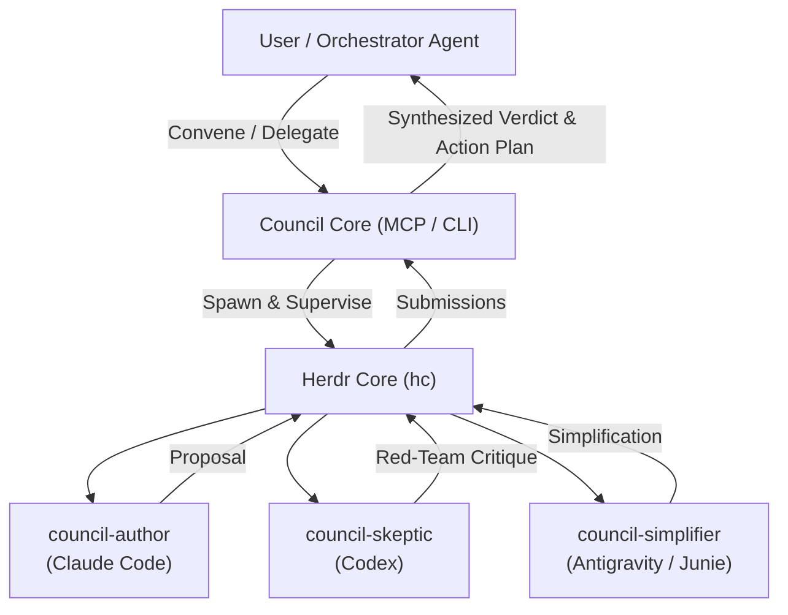

# Council (v2.0)

> **Herdr-native multi-agent collaboration plugin for Claude Code, Codex, Antigravity, Junie, and all AI coding assistants.**

Council coordinates teams of AI agents to solve complex engineering challenges through structured deliberation, independent peer review, formal debate, and consensus synthesis. Built specifically to run on top of **Herdr** (`hc`), Council launches agents into persistent, visible terminals that humans and agents can observe and steer in real time.



---

## Highlights

- **Zero Production Dependencies**: Runs on modern Node.js (`>= 20`) without installing or maintaining third-party npm packages.
- **Herdr-Native**: Automatically formats and spawns real interactive agent terminals inside Herdr (`hc run --bg ...`), tracks turn states with `hc wait`, and reads screen buffers with `hc read`.
- **Universal Plugin Support**:
  - **Antigravity (AGY)**: Native plugin manifest (`plugin.json`), MCP integration (`mcp_config.json`), rules, and progressive disclosure skills.
  - **Claude Code**: Packaged `.claude-plugin/`, marketplace metadata, slash command (`/council`), and `.mcp.json`.
  - **OpenAI Codex**: Configured `.codex-plugin/` and skills.
  - **Junie**: Native skill loader support via `skills/council/SKILL.md`.
  - **Cursor / Windsurf / OpenCode / Zed**: Standard Model Context Protocol (MCP 2024-11-05) over stdio.
- **6 Collaboration Modes**:
  1. **Council**: Full multi-perspective panel (Author, Skeptic, Simplifier, Judge) to solve consequential architectural decisions.
  2. **Review**: Multi-reviewer peer inspection (Correctness + Radical Simplification).
  3. **Debate**: Two competing viewpoints argued vigorously and settled by an impartial referee.
  4. **Parallel**: High-throughput fan-out across multiple independent subtasks.
  5. **Pipeline**: Sequential staged handoffs (Spec &rarr; Implementation &rarr; Verification).
  6. **Delegate**: Single bounded subtask offloaded to a designated specialist agent.

---

## Quickstart

### 1. Check Environment Health

Verify that Herdr (`hc`) and your agent CLIs are detected:

```bash
node bin/council.js doctor
```

Output:
```text
--- Council Environment Health Check ---
Herdr Core CLI (hc): Available (hc 0.1.21)
Current Session:     Inside Herdr terminal (t106)

Supported Agent CLIs:
  - claude      : Ready (C:\Users\djeeju\.local\bin\claude.exe)
  - codex       : Ready (C:\Users\djeeju\AppData\Roaming\npm\codex)
  - antigravity : Ready (C:\Users\djeeju\AppData\Local\agy\bin\agy.exe)
  - junie       : Ready (C:\Users\djeeju\.local\bin\junie.bat)
```

### 2. Convene a Council

```bash
# Full multi-perspective council
node bin/council.js convene --mode council --task "Design a high-throughput event processing pipeline"

# Focused peer review on a file or diff
node bin/council.js convene --mode review --task "Review src/auth.js for session hijacking vulnerabilities"

# Delegate a task to Codex
node bin/council.js delegate --agent codex --task "Generate comprehensive property tests for tokenizer"
```

---

## Host Integration Guide

### 1. Antigravity (AGY)
- **Automatic Discovery**: If Council is located in your workspace or linked into `~/.gemini/config/plugins/council`, Antigravity detects `plugin.json` and loads the `council` skill and MCP tools automatically.
- **Manual Registration**: Add to your project `.agents/plugins.json` or `config.json`:
  ```json
  {
    "mcpServers": {
      "council": {
        "command": "node",
        "args": ["C:/Users/djeeju/Documents/Tools/Council/bin/council.js", "mcp"]
      }
    }
  }
  ```

### 2. Claude Code
- Load directly via CLI flag:
  ```bash
  claude --plugin-dir C:/Users/djeeju/Documents/Tools/Council
  ```
- Or link into Claude's global MCP settings:
  ```json
  {
    "mcpServers": {
      "council": {
        "command": "node",
        "args": ["C:/Users/djeeju/Documents/Tools/Council/bin/council.js", "mcp"]
      }
    }
  }
  ```
- Use the `/council` slash command inside Claude Code.

### 3. OpenAI Codex
- Register in your Codex config (`~/.codex/config.toml` or MCP settings):
  ```toml
  [mcp_servers.council]
  command = "node"
  args = ["C:/Users/djeeju/Documents/Tools/Council/bin/council.js", "mcp"]
  ```

### 4. Junie
- Link or copy `skills/council` to `~/.junie/skills/council`.
- Junie loads the skill automatically during sessions.

### 5. Cursor, Windsurf, Zed & Other MCP Hosts
Add to your editor's `mcp.json`:
```json
{
  "mcpServers": {
    "council": {
      "command": "node",
      "args": ["C:/Users/djeeju/Documents/Tools/Council/bin/council.js", "mcp"]
    }
  }
}
```

---

## MCP Tools Reference

| Tool | Parameters | Description |
|---|---|---|
| `council_status` | none | Reports Herdr version, active terminals, and agent availability. |
| `council_convene` | `task`, `mode`, `context`, `criteria`, `agents`, `permission`, `timeoutSec` | Executes full collaboration workflow and returns a markdown report. |
| `council_delegate` | `agent`, `task`, `permission`, `context`, `timeoutSec` | Delegates a single subtask to an agent in Herdr. |
| `council_wait` | `target`, `timeoutSec` | Non-blocking wait for terminal turn completion using `hc wait`. |
| `council_read` | `target`, `lines` | Retrieves recent output buffer from a Herdr terminal. |
| `council_send` | `target`, `message` | Sends steering input or follow-up to an agent in Herdr. |
| `council_dismiss` | `target` | Terminates and removes a terminal from Herdr (`hc kill` + `hc rm`). |

---

## Agent Launch Recipes under Herdr

Council applies verified, safe Windows launch recipes:

| Agent | Read-Only (Plan) | Write (Edit) | Notes |
|---|---|---|---|
| **Claude Code** | `claude --permission-mode plan` | `claude --permission-mode acceptEdits` | Trailing task argument |
| **Codex** | `codex --no-daemon -s read-only -a never` | `codex --no-daemon -s workspace-write -a never` | Must have `--no-daemon` under Herdr |
| **Antigravity** | `agy --mode plan -i "<task>"` | `agy --mode accept-edits -i "<task>"` | Task is value of `-i` |
| **Junie** | `junie --plan "--prompt=<task>"` | `junie "--prompt=<task>"` | Requires `--prompt=` to stay interactive |

Long briefs are automatically saved to `.council/briefs/` to avoid command line length limits and character corruption on Windows.

---

## License

MIT &copy; Ejupi-Labs.
