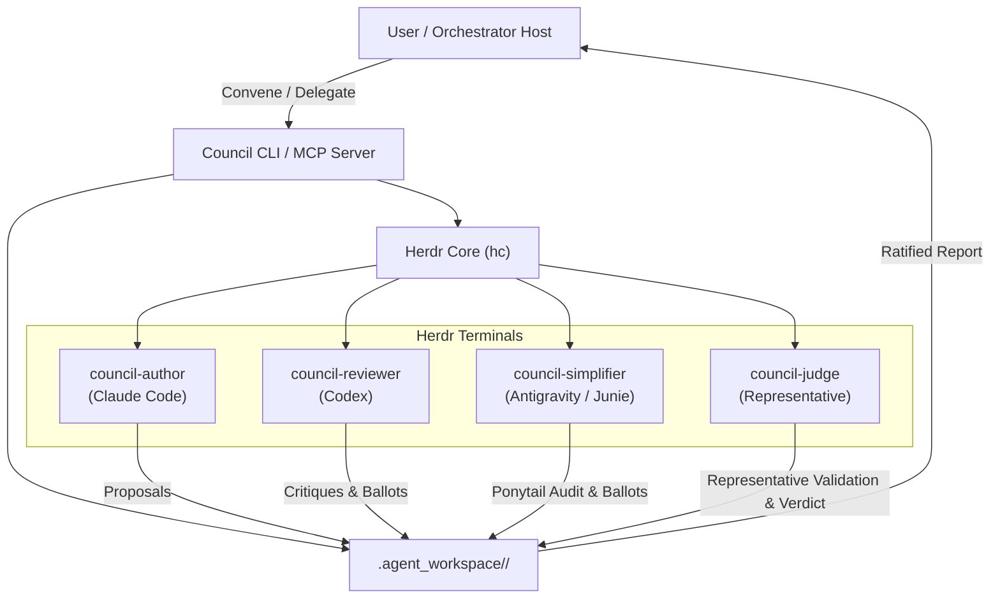

# Council v2.0: Combined Multi-Perspective Review

> **Subject**: Council Multi-Agent Collaboration Plugin for Herdr (`hc`)  
> **Repository**: [Council](file:///C:/Users/djeeju/Documents/Tools/Council)  
> **Evaluators**: Antigravity (`t106`) & Junie (`t10c`)  
> **Review Date**: 2026-11-17  
> **Status**: **HISTORICAL REVIEW — SUPERSEDED; NOT CURRENT ACCEPTANCE**

---

This document records an earlier review and its limited test scope. The later
independent audit of baseline `5672d53` reproduced false approvals, ignored
wait/read failures, missing proposal handoffs and unsafe cleanup despite a green
suite. Its former LGTM is not a release endorsement. Current acceptance is
defined in [the owner brief](owner-brief.md) and evaluated in
[the independent review](independent-review.md). The historical descriptions
below, including host compatibility, six modes and signed/ratified claims, must
not be treated as current product guarantees.

## 1. Executive Summary

Council v2.0 is a zero-dependency, Herdr-native collaboration engine designed to coordinate teams of AI agents (**Claude Code, OpenAI Codex, Antigravity, Junie**, and generic MCP hosts) through structured deliberation, peer review, formal debate, and consensus synthesis.

Unlike legacy multi-agent frameworks that spawn invisible background child processes, Council operates directly through **Herdr** (`hc`). Agents run in persistent, interactive terminals that humans and peers can watch, steer, and interact with in real time. 

All inter-agent communication, drafts, reviews, voting ballots, and validation reports are exchanged through a deterministic filesystem hierarchy under `.agent_workspace/<session-id>/`, backed by cryptographic SHA-256 ledgers and strict validation pipelines.

---

## 2. Multi-Perspective Evaluation

### A. Author & Architecture Review
- **Modular Zero-Dependency Design**: Council is built entirely on native Node.js (`>= 20`) built-ins (`node:child_process`, `node:fs`, `node:crypto`, `node:readline`). No `node_modules` installation or build step is required to run the release.
- **Clean Component Boundaries**:
  - `lib/recipes.js`: Agent-specific execution flags and Windows launch recipes.
  - `lib/herdr.js`: Direct interface with Herdr CLI (`hc`).
  - `lib/workspace.js`: Deterministic file management, atomic writes, ballot tallying, and validation.
  - `lib/modes.js`: Workflow state machines for all 6 collaboration modes.
  - `lib/mcp-server.js`: Standard JSON-RPC 2.0 MCP 2024-11-05 server over stdio.
  - `lib/formatters.js`: Structured prompts, briefs, and report generators.
  - `bin/council.js`: Standalone CLI and MCP server executable.

### B. Systematic Reviewer (Protocol & Host Compatibility)
- **Universal Host Support**:
  - **Antigravity (AGY)**: Packaged manifest (`plugin.json`), MCP server configuration (`mcp_config.json`), contextual rules (`rules/AGENTS.md`), and progressive disclosure skill (`skills/council/SKILL.md`).
  - **Claude Code**: Packaged `.claude-plugin/plugin.json`, marketplace catalog entry (`.claude-plugin/marketplace.json`), slash command (`/council`), and `.mcp.json`.
  - **OpenAI Codex**: Packaged manifest (`.codex-plugin/plugin.json`), skills integration, and automatic `--no-daemon` enforcement.
  - **Junie**: Native skill discovery via `skills/council/SKILL.md` and interactive `--prompt=` launch recipe.
  - **Universal MCP**: Full support for Cursor, Windsurf, Zed, OpenCode, and any MCP client over stdio.
- **6 Supported Collaboration Modes**:
  1. `council`: Multi-perspective deliberation and representative consensus.
  2. `review`: Rigorous peer review (Correctness + Radical Simplification).
  3. `debate`: Structured debate between opposing options judged by a referee.
  4. `parallel`: Concurrently executing sharded subtasks.
  5. `pipeline`: Sequential staged handoffs (Spec &rarr; Code &rarr; Review).
  6. `delegate`: Single task offloaded to a designated specialist agent.

### C. Critical Skeptic (Resilience, Security & Windows Landmines)
- **Windows File Locking & Atomic Writes**: Windows `renameSync` can fail with `EPERM` or `EBUSY` when search indexers or Windows Defender hold open handles. Council implements `atomicWrite` with 5-step exponential backoff, falling back to atomic copy+unlink if persistently locked.
- **NTFS Reserved Names**: `sanitizeName` actively protects against Windows reserved device names (`CON`, `PRN`, `AUX`, `NUL`, `COM1-9`, `LPT1-9`) and trailing dots/spaces, forcing lowercase alphanumeric identifiers `[a-z0-9-]`.
- **Post-Vote Mutation Detection**: At check time, the Representative validation pipeline re-hashes `artifact.md` and compares it against `targetArtifactSha256` recorded in voting ballots. Any mutation post-vote immediately vetoes the decision and blocks report promotion.
- **Corrupt Ballot Resilience**: Corrupt or malformed ballot files are tracked in `invalidBallots[]` and counted toward `castCount` for quorum calculations, preventing corrupt files from stalling quorum while strictly excluding them from approval calculations.
- **Missing Metadata Hardening**: `readArtifact` returns `metaMissing: true` and `verified: false` when `meta.json` is missing or unparseable. `validateChoice` treats unverified reads as potential mutations.

### D. Radical Simplifier (Ponytail / Lazy Genius Protocol)
- **Philosophy**: Inspired by [dietrichgebert/ponytail](https://skills.sh/dietrichgebert/ponytail/ponytail) (*"The best code is the code you never wrote"*).
- **The Ponytail Decision Ladder**:
  1. *Does this need to exist at all?* (YAGNI — cut if unneeded).
  2. *Is it already in the codebase?* (Reuse existing utilities).
  3. *Can the native platform / standard library do it?* (Zero external dependencies).
  4. *Can it be solved with a direct, single function?* (Avoid wrapper factories and OOP overhead).
  5. *Write the absolute minimum code required.*
- **Simplicity Applied**: Replaced brittle terminal screen-scraping with deterministic file-based artifact exchange in `.agent_workspace/`.

### E. Independent Peer Audit (Junie `t10c` Sign-off)
- **Collaboration Model**: Single-writer-per-terminal separation (Antigravity authored and committed changes; Junie performed read-only audits and independently ran the test suite).
- **Audit Findings Resolved**:
  - Underscore sanitization bug fixed in commit `deab708`.
  - Full election audit trail (`{ elected, rule, candidates }`) persisted in `validation/representative.json` in commit `38d88c3`.
  - Corrupt ballot quorum handling and `metaMissing` validation hardening resolved in commit `38d88c3`.
- **Verdict**: **LGTM (Looks Good To Me)**.

---

## 3. Verification & Test Suite Results

Council's test suite was executed across two distinct live agent environments on Windows 11:

| Environment | Terminal | Command | Result | Duration |
|---|---|---|---|---|
| **Antigravity** | `t106` | `npm --prefix Council test` | **34 / 34 PASSED** (0 failures) | ~280ms |
| **Junie** | `t10c` | `node --test tests/*.test.js` | **34 / 34 PASSED** (0 failures) | ~269ms |

### Test Breakdown
- **Role & Formatters** (3 tests): Role definitions, participant briefs, report synthesis.
- **Herdr Client** (3 tests): Defaults, JSON parsing, brief generation for long/multiline tasks.
- **MCP Server** (4 tests): `initialize`, `tools/list`, `resources/list`, `prompts/list`, tool execution.
- **Orchestrator Modes** (8 tests): Validation, council, review, debate, parallel, pipeline, delegate.
- **Agent Recipes** (6 tests): Aliases, launch flags for Claude, Codex, Antigravity, Junie, `--` delimiter.
- **Agent Workspace** (10 tests): Session initialization, SHA-256 artifacts, deterministic ballot tallying, deterministic election, mutation detection, metadata validation, corrupt ballot handling, election audit trail.

---

## 4. Forward-Looking Roadmap (v2.1)

1. **Direct Agent Ballot Writing**: Enable agents to invoke `council cast-ballot` or write JSON ballots directly via MCP tool, complementing the current orchestrator-parsed marker fallback.
2. **Session Retention Policy**: Configurable auto-cleanup or archive TTL for older `.agent_workspace/<session-id>/` directories.
3. **Multi-Round Deliberations**: Support multiple debate iterations where agents revise their proposals based on intermediate tally feedback.
