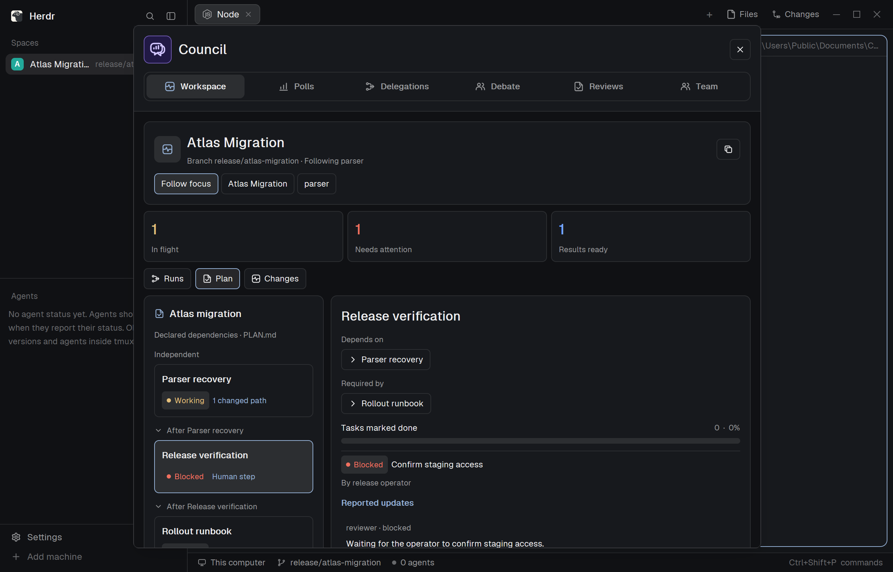

# Workspace activity

**Council → Workspace** follows the focused Herdr terminal’s project. When the terminal enters a subfolder, Workspace looks for the nearest plan or Council storage within the Git worktree and the active space’s folder boundary. Pin a folder to keep an exact scope. Select a run, poll, discussion, or review to inspect the source record. **Back to Workspace** restores the original view and filters, including after following a Team handoff. Select **Read issues** when it appears to inspect a record or Git read problem.



| Signal | What Workspace shows |
| --- | --- |
| **Council record** | Delivery states, deadlines, completion, saved results, and Team process shutdown. New delegations record individual transitions. Older jobs show the milestones available in their saved record. |
| **Live in Herdr** | Agents visible in the selected folder. Select a terminal to focus it. |
| **Reported** | Progress, blockers, and handoffs attached to a delegation via Desktop, CLI, or MCP. The update can point to a plan component. |
| **Declared** | Components, dependencies, authorship labels, and task states from the project's optional `PLAN.md`. Plan progress counts tasks marked done. |
| **Observed in Git** | Working-tree paths, branch and worktree context, and recent commit subjects. A matching path can appear on multiple components. Git paths carry no agent attribution. |

## Plan a project

The parser supports the component convention used by [AgentTrail](https://github.com/sodiumsun/agenttrail#draw-the-component-map). Use stable `{#id}` headings and project-relative file patterns. Patterns accept `*` and `?` within a path segment and `**` for recursive matching. `needs:` and `links:` connect components. `kind: human` marks an operator step, and `kind: knowledge` marks reference work. Task states are `[ ]` pending, `[~]` working, `[!]` blocked, and `[x]` marked done. Indented `by:`, `from:`, and `evidence:` annotate a task. Use `## decisions` for durable project decisions.

See the [Council project plan](../PLAN.md) for a working example. Plan groups components by declared dependency order. Select a component to navigate its prerequisites, dependents, and related components. Missing targets and cycles appear in the unresolved lane and under **Plan checks**. Without a plan, **Changes** still shows the observed Git context.

## Report or inspect a run

```bash
council activity
council activity --session parser-check
council activity report --session parser-check --state blocked --component parser --text "Waiting for the recovery fixture."
```

The MCP tools are `council_activity` and `council_report_progress`. An explicit absolute `project` scopes the request. In Desktop, open a delegation and select **Add update**. For a Team run, **Called by** and **Calls made from this run** link to the recorded upstream and downstream sessions.

Notes are appended under `.agent_workspace/<session>/progress/`. They leave task delivery, terminal ownership, artifacts, and formal approval unchanged. A note can report a blocker while Council's recorded job is still active. Historical timeline entries carry the times that were recorded, with unavailable times left empty.

Desktop supplies a stable request ID for each update. For CLI and MCP retries, pass the same `--request-id` or `requestId` with the original content. Council returns the saved note if it already accepted the request. A fresh note brings an older run back into Workspace’s recent list.

## Concepts adapted from AgentTrail

- **Stable project structure and live work.** Components are declared independently of runs. Operator navigation moves from a project to a component or a run. [AgentTrail zoom model](https://github.com/sodiumsun/agenttrail/blob/main/docs/ZOOM.md)
- **Evidence and provenance.** Council displays its own protocol receipts, bounded Git observations, and reported notes with their source visible. A reported completion in a plan remains a plan annotation. [AgentTrail observability](https://github.com/sodiumsun/agenttrail/blob/main/docs/OBSERVABILITY.md)
- **Provider-neutral updates.** AgentTrail accepts events from provider adapters. Council accepts explicit notes on Council sessions through the same local project interfaces used for its jobs. This increment reads no provider conversation logs and installs no hooks or HTTP service. [AgentTrail ingestion](https://github.com/sodiumsun/agenttrail/blob/main/docs/INGEST.md)
- **Context without a plan.** Git supplies branch, worktree, commit, and scoped file metadata. Council leaves lineage and ownership unassigned when the available evidence does not establish them. [AgentTrail Git workstreams](https://github.com/sodiumsun/agenttrail/blob/main/bin/lib/workstreams.mjs)
- **Native access beside the agent.** Workspace follows Herdr focus and opens the existing terminal, task, or decision from the overview. [AgentTrail for Herdr](https://github.com/sodiumsun/agenttrail/blob/main/herdr/README.md)

The overview reads Council records and the selected project's plan and Git metadata. Git operations and their output are bounded. The view displays a bounded recent slice per run state, with complete archived records available in **Delegations**. Plan edits and progress writes are explicit actions.
