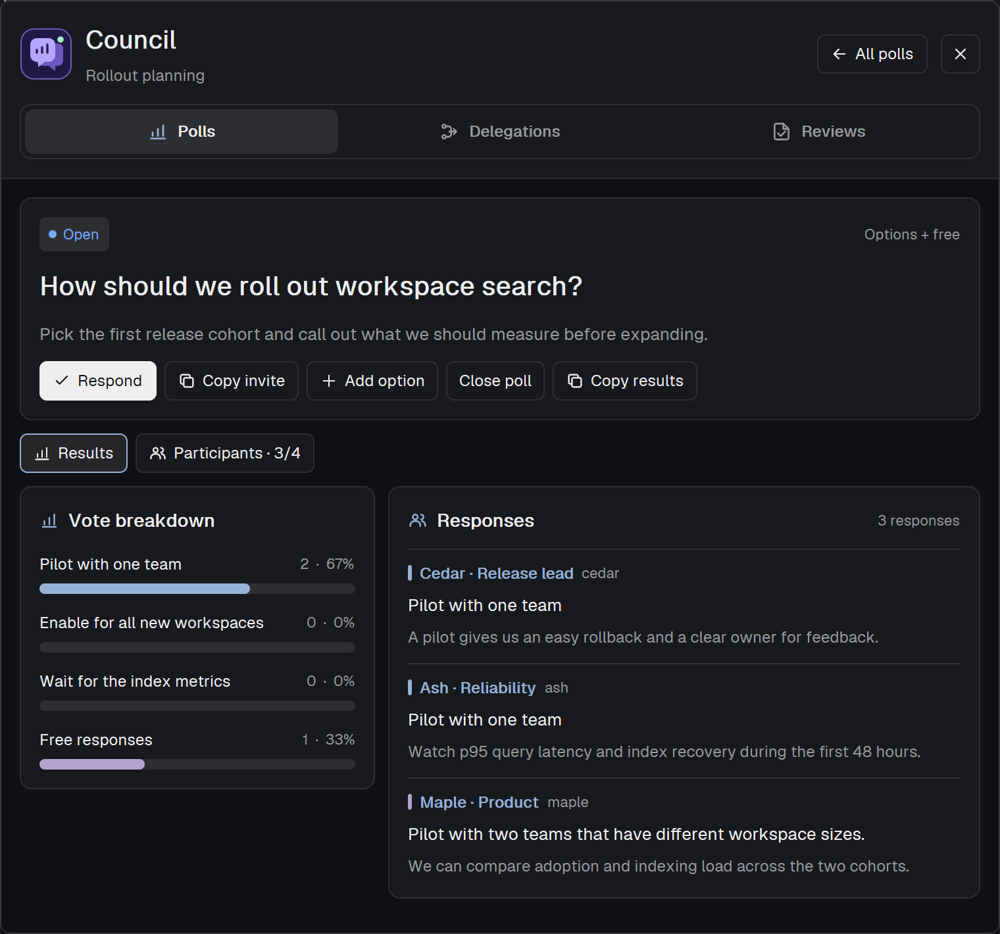

# Council

Council is a native collaboration panel for an active Herdr workspace. Ask its agents a question, see their responses and reasoning, and copy the decision as a handoff. Follow asynchronous delegations and open saved formal reviews in the same window.



## What you see

The **Council** entry in the sidebar uses a purple conversation mark and opens a native menu for **Workspace**, **Polls**, **Delegations**, **Debate**, **Reviews**, and **Team**. Select **All local spaces** in the record lists to include projects from other open spaces and their terminal folders. Details use side-by-side cards on wider windows and stack on narrower windows.

**Workspace** follows the focused local terminal's folder, with explicit folder pinning in spaces that contain multiple projects. Its Runs view links to Council jobs and pending decisions. Plan reads stable headings, task checkboxes and dependencies from an optional `PLAN.md`. Changes shows observed Git paths, worktrees and recent commits. Delegations show recorded milestones, separate reported updates and links between related Team calls. Add updates in a run detail or with the activity CLI/MCP tools.

## How it behaves

Click **Council** and choose a section with the mouse or arrow keys and Enter. Esc dismisses the menu. The optional Shift+F8 binding and the Herdr mod-open command also open Council. Drag the header to move the window. In Polls, create a poll with listed options, free responses, or both. Search by question or poll ID. Options can be added while the poll is open, and the same voter can revise a response. Closing freezes the options, responses and roster and can record the next step. Copy results or the decision to use in a handoff.

In Participants, track an agent, copy an invitation scoped to its voter ID, or open its terminal. Live terminal labels are Idle, Working, Done, and Needs you. They use Herdr's idle, working, done, and blocked colors. A missing live terminal shows Terminal unavailable. Response states are Pending, Responded, and No response after closing. The poll still counts responses from outside the roster. Reviews shows submitted direct ballots while the session runs, followed by the saved verdict, formal quorum, invalid or missing ballots, and dissent.

In the poll and debate forms, choose agents under **Invite agents**. Each row shows the terminal address, its project folder and live status. The form starts with no recipients selected. Delivery runs in Herdr and follows agent readiness for up to 15 minutes. Reopening Council in that space resumes the saved queue within the original window. The open item shows delivery status and flags uncertain deliveries for manual inspection. Debate rooms accept replies from Desktop, the bundled CLI, and MCP. Debate also follows Council and review sessions as threads, with a link to the formal tally and verdict.

**Create poll** opens an editable form from a debate and links the two records in the same project. **Close with decision** saves a decision, an owner, and a next step, then closes the discussion to replies and pending invitations. The decision card is copyable. Formal ballots show their match to the proposal digest for their round next to the vote and score.

Delegations reads asynchronous jobs started in the project from CLI or MCP. Filter for Active, Needs attention, or Ready. A detail shows the assigned terminal, acknowledgement, remaining time, recorded wait event, and any error. The Terminal capture card appears alongside the delivery record. It can copy saved output and the path to the full capture. Opening a live terminal leaves the panel visible. An elapsed deadline or uncertain delivery is shown even when a worker has saved no result.

In **Delegations**, select **Delegate task** to send a bounded assignment to an agent. In **Team**, select **Call member** to start a turn with the member's saved agent, model and project access. Both forms open the saved session. The Team tab shows the last known power state and links to the latest turn. Completed managed models shut down after Council archives the result and start again on an explicit call.

## Built from

`mods/council/mod.json` registers the dashboard window. `navigation.js` draws the native sidebar launcher and popup. `poll-view.js` renders the tally and roster, `poll-text.js` formats invitations and summaries, and `discussion-view.js` draws the debate thread. Herdr supplies project folders from `spaces()` and `panes()`, the live roster from `agents()`, and navigation through `agent.focus`.

The window runs `runtime/council.mjs desktop <action>` through `herdr.exec` in the active local project directory and reads JSON from stdout. The Node helper reads Council session records and stores poll and team data inside `.agent_workspace/`. Delegations reads `job.json` and its dispatch sidecar with the same result and dispatch checks as the CLI. The repository CLI and MCP import the same stores. The bundled polling CLI also works when invoked directly from the target project directory:

```bash
node /path/to/herdr-app/mods/council/runtime/council.mjs poll help
```

From the repository, run `node herdr/install.js --menu --shortcut`. The installer includes the Council execution engine, records the Node executable, and adds the launcher to a personal layout. For a manual Gallery copy, add `"cli": "/absolute/path/to/bin/council.js"` to the mod's `config.json` to enable native task launches. When the selected layout is shipped with Herdr, choose the `council-<name>` copy printed by the installer.

For a manual Gallery installation, copy the complete `mods/council/` directory, including `runtime/` and `icons/`, into the Herdr app home's `mods/`. In a personal layout, insert this block after the workspace brand in the sidebar column. Use Herdr's layout clone command first if your layout ships with Herdr.

```json
{
  "id": "council-menu",
  "type": "block",
  "size": { "px": 44 },
  "content": { "mod": "council", "props": { "role": "launcher" } }
}
```

Merge `keys.json` if Shift+F8 is free. You can also open the window with `herdr-app do mod.open --name council`.

## Watch out

- Use Herdr Desktop with Node.js 20 or newer. The bundled runtime works independently of the checkout. For a manual copy, Node must be on Herdr's PATH or named in the installed mod's optional `config.json` as `{"node":"/absolute/path/to/node"}`.
- The active space must be local. Refresh runs every five seconds. The project filesystem must support hard links. Linked storage directories are rejected.
- The mod uses the filesystem, local Node process, clipboard, and Herdr terminal delivery. Poll and debate participation uses local terminal IDs and project write access. A read-only agent can reply in its conversation. Formal reviews use Council's separate rules.
- The editor supports up to 20 options and 32 tracked agents. The installed mod identifier is `council`.

## Done when

- `herdr-app check mods/council` passes and the manually copied bundle opens in a local space with Node on PATH.
- The Council sidebar menu opens each destination with a click or the keyboard, with one dashboard window.
- A mixed poll shows a listed vote and a free response from the CLI. A response saved in the panel appears in the CLI.
- Tracking an existing agent shows it as pending until a response arrives under its terminal address. Untracking keeps its response in the results.
- An added option appears in results. A closed poll shows its decision and refuses further changes.
- A saved provisional review is labeled provisional and its missing direct votes remain missing.
- A delegated task shows its acknowledged delivery and saved terminal capture. Uncertain delivery and expired sessions remain visible under Needs attention.
